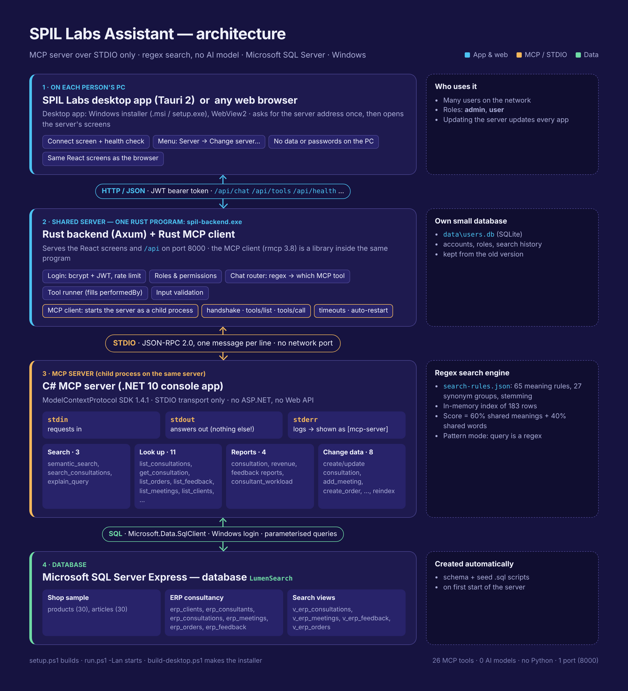

# SPIL Labs Assistant: MCP search and ERP consultation tools over Microsoft SQL Server

A chat assistant where people type questions in plain language ("which consultations are in
progress?", "my parcel never showed up") and get the matching rows from a **Microsoft SQL Server**
database. It runs on **one shared server**; people use it from the **SPIL Labs desktop app** or a
normal **web browser**.

Matching is done with **regular expressions only**: no AI model, no vectors, no internet.
Regex "meaning rules" recognise what a question is about. For example, *"never showed up"*,
*"where is my package"* and *"has not arrived"* all mean **Delivery problem**.

```
 Desktop app (Tauri)  or  web browser          ← on each person's PC
     │  HTTP / JSON  (login token on every request)
     ▼
 ┌─ spil-backend.exe (Rust) ──────────────────┐  ← on the shared server
 │  web server: screens + /api, logins, roles │
 │  chat rules: which MCP tool answers        │
 │  MCP client (Rust library, built in)       │
 └────────────────────────────────────────────┘
     │  starts the C# server as a CHILD PROCESS and speaks
     │  JSON-RPC over its stdin / stdout  (STDIO, no port)
     ▼
 C# MCP server  (.NET console app, no web API)
     │  SQL
     ▼
 Microsoft SQL Server  (database LumenSearch)
```



## Folders

| Folder | What it is | Language |
|---|---|---|
| `server-dotnet/` | The MCP server: SQL Server access, the regex search engine, the 26 tools | C# (.NET 10) |
| `server-dotnet/.../Rules/search-rules.json` | **The meaning rules**: concepts, synonyms, stop words, stemming. Edit freely. | JSON + regex |
| `server-dotnet/.../Database/` | T-SQL scripts: tables and sample data | SQL |
| `client-rust/spil-backend/` | **The backend**: web server, logins, chat rules, `/api` | Rust (Axum) |
| `client-rust/mcp-client/` | The MCP client library used by the backend, plus the `mcp-cli` terminal tool | Rust (rmcp) |
| `frontend/` | The screens: chat, tools, admin | React + TypeScript |
| `desktop/` | The desktop app: a window with the SPIL Labs icon that opens the server's screens | Rust (Tauri 2) |
| `config/` | `server.env`: the server's settings and secrets (created by setup) | |
| `data/` | `users.db`: the accounts | SQLite |
| `scripts/` | Setup, run and build scripts for Windows | PowerShell |

## Install the shared server (Windows)

Do this **once, on the PC that will be the server**.

**1. Install these once:**

- [.NET 10 SDK](https://dotnet.microsoft.com/download)
- [Rust](https://rustup.rs). Choose the MSVC toolchain. It also needs **Visual Studio Build Tools** with "Desktop development with C++".
- [Node.js 20 or newer](https://nodejs.org)
- **Microsoft SQL Server 2019 or newer.** The free **Express** edition is enough. From [sql-server-downloads](https://www.microsoft.com/sql-server/sql-server-downloads), choose *Express → Download now → Basic*.

Python is **no longer needed**.

**2. Run the setup** from the project folder, in PowerShell:

```powershell
powershell -ExecutionPolicy Bypass -File scripts\setup.ps1
```

The setup script:

- **finds SQL Server** automatically, e.g. `localhost\SQLEXPRESS`;
- builds the C# server and **creates the `LumenSearch` database** with sample data;
- builds the Rust backend (`dist\spil-backend.exe`) and the screens;
- writes `config\server.env` and asks for an admin username and password (only when there are no accounts yet);
- runs a test search through the whole chain.

**Updating from the old Python version:** unzip the new version **over your old project folder** and
run setup. It copies `backend\.env` → `config\server.env` and `backend\data\users.db` → `data\users.db`.
Everyone keeps their account and password, and nobody is signed out. Then you can delete the old `backend` folder.

You can also tell it which SQL Server to use:

```powershell
scripts\setup.ps1 -SqlServer "OFFICE-SQL01\SQLEXPRESS" -Database LumenSearch
scripts\setup.ps1 -ConnectionString "Server=OFFICE-SQL01;Database=LumenSearch;User ID=lumen;Password=...;TrustServerCertificate=True"
```

The server signs in to SQL Server with **your Windows account** (`Trusted_Connection=True`), so
no SQL password is needed. The account needs permission to create a database the first time.

**3. Start the server:**

```powershell
powershell -ExecutionPolicy Bypass -File scripts\run.ps1 -Lan     # shared: other PCs can connect
powershell -ExecutionPolicy Bypass -File scripts\run.ps1          # only this PC: http://localhost:8000
```

It prints the **server address** (e.g. `http://192.168.1.25:8000`) and the firewall command to allow the port once.
Keep the window open while people use it.

**4. Add people.** Sign in as the admin, then open **Admin → Add a person**. Then delete the
`ADMIN_PASSWORD=` line from `config\server.env`.

## The desktop app

**Build the installer once** (on any Windows PC with Rust, the Build Tools and Node.js):

```powershell
powershell -ExecutionPolicy Bypass -File scripts\build-desktop.ps1
```

It creates two installers in `desktop\src-tauri\target\release\bundle\` — use either one:

- `msi\SPIL Labs Assistant_1.0.0_x64_en-US.msi`
- `nsis\SPIL Labs Assistant_1.0.0_x64-setup.exe`

**Give the installer to people.** On first start the app asks for the **server address**, checks it,
remembers it and opens the sign-in screen. Next time it goes straight there.
To switch servers: menu **Server → Change server…** (Ctrl+Shift+S).

- The app holds **no data and no passwords**: everything stays on the server.
- It shows the server's screens, so **updating the server updates every app**; reinstalling is only needed when the app itself changes.
- It uses Microsoft Edge WebView2, which is built into Windows 10 and 11 (the installer downloads it if missing).
- People who prefer a **browser** simply open the server address.

## The chat

The home screen is a chat with SPIL Labs branding. Type a question the way you'd say it. There is **no AI model**:
regex rules in `client-rust\spil-backend\src\chat.rs` decide which MCP tool answers, and each reply shows the tool and arguments used.

| You type | Tool it runs |
|---|---|
| *Which consultations are in progress?* | `list_consultations` (status In progress) |
| *show urgent payroll consultations for Kandy Hills* | `list_consultations` (priority, module, client) |
| *consultation 4* | `get_consultation` |
| *upcoming meetings* | `list_meetings` (upcoming only) |
| *show bad feedback* | `list_feedback` (rating 2 or less) |
| *list unpaid orders* | `list_orders` (Confirmed or Invoiced) |
| *revenue by month* · *customer satisfaction by module* · *how many consultations per consultant* | `revenue_report` · `feedback_report` · `consultation_report` |
| *who is the busiest consultant?* | `consultant_workload` |
| `/E-\d{3}/` (between slashes) | `semantic_search` in regex pattern mode |
| anything else, e.g. *unhappy clients* | `semantic_search` (meaning search) |

- **Narrowing searches:** the drop-downs under the message box choose where meaning searches look, and how they match.
- **Opening a consultation:** select a row in a table that has a consultation to see the full consultation.
- **Saved chats:** conversations are kept in the sidebar for the current browser tab only.
- **Read-only:** the chat never changes data; use the **Tools** page for that.
- **Logo:** to change it, replace `frontend\public\spil-labs-logo.png` (wordmark) and `spil-labs-mark.png` (dots only), then run `npm run build` in `frontend`.

## How a search works, step by step

1. **You type a question.** React sends `POST /api/search` with your login token.
2. **The Rust backend checks it.** It verifies the token and your role, validates the input, and calls `mcp.call_tool("semantic_search", {...})` on its built-in MCP client.
3. **The MCP client sends an MCP request.** It writes a JSON-RPC `tools/call` message to the C# server's **stdin**.
4. **The C# server analyses the question with regex:**
   - **Words:** the regex `\w+(?:[-']\w+)*` splits the question into words. Stop words such as "the" and "my" are dropped.
   - **Stemming:** regex suffix rules cut endings, so *charging* becomes *charg*.
   - **Synonyms:** *package* counts as *parcel*.
   - **Concepts:** every concept's patterns run over the whole question. `\bwhere('?s| is) my (parcel|package|order)` matches *where is my package*, so it is tagged **Delivery problem**.
5. **The server scores every row.** At startup it read all rows from SQL Server and tagged them the same way. For each row it calculates:

   ```
   score = 0.6 × (share of the question's concepts the row has)
         + 0.4 × (share of the question's words the row has)
   ```

   Rare words and concepts count more than common ones, and a match in the title counts a little more.
   The best rows are read from SQL Server and returned with **why** they matched: the concepts, the
   words and the best sentence.
6. **The answer comes back.** It goes out through the server's **stdout**, then to the Rust backend, then the screen.

### Three search modes

| Mode | What it does | Example |
|---|---|---|
| **Meaning** (default) | Concept rules plus shared words | `my parcel never showed up` |
| **Words only** | Shared words, after stemming and synonyms | `noise cancelling headphones` |
| **Regex pattern** | Your query **is** a regular expression, case-insensitive | `E-\d{3}`  or  `(refund\|money back)` |

### Teaching it new meanings

Open `server-dotnet\SemanticSearch.McpServer\Rules\search-rules.json`. To make *"where's my stuff"*
count as a delivery problem, add a pattern to that concept:

```json
{ "name": "delivery_problem", "label": "Delivery problem", "patterns": [
    "\\bwhere('?s| is) my (parcel|package|order|delivery|stuff|item)",
    ...
```

In JSON every backslash is written twice (`\\b`). Then, as an admin, press **Admin → Reload rules
and data**; no restart is needed. Use **Admin → Test a question against the rules** to see which
rules fire. If the file has a mistake, the old rules stay active and you'll see an error message.

**The trade-off:** regex rules only understand the meanings someone has written. A question about
something no rule covers falls back to word matching.

### The MCP tools the server offers

| Tool | What it does |
|---|---|
| `semantic_search` | Takes `query`, `topK`, `minScore`, `source` and `mode` (`semantic` / `keyword` / `pattern`). Returns ranked rows, with scores and the reasons they matched. |
| `explain_query` | Shows how the rules read a question: the words compared and the concepts recognised, with the matching regex |
| `get_record` | Returns the full row for a `source` and `id` |
| `list_sources` | Lists the searchable tables, with row counts |
| `index_status` | Shows the method, the record and rule counts, the SQL Server version and the rules file |
| `reindex` | Reloads the rules file and re-reads the SQL Server tables |

There are 20 more tools for the ERP consultations; see the ERP consultations section.

Try them from the terminal with the Rust CLI:

```powershell
$cli = @("--server", "$PWD\dist\server\SemanticSearch.McpServer.exe",
         "--server-arg", "--connection", "--server-arg", "Server=localhost\SQLEXPRESS;Database=LumenSearch;Trusted_Connection=True;TrustServerCertificate=True",
         "--server-arg", "--rules", "--server-arg", "$PWD\server-dotnet\SemanticSearch.McpServer\Rules\search-rules.json", "--quiet")
dist\mcp-cli.exe @cli tools
dist\mcp-cli.exe @cli search "headphones for long flights" --top-k 3
dist\mcp-cli.exe @cli search "E-\d{3}" --mode pattern
dist\mcp-cli.exe @cli call explain_query '{\"query\":\"where is my package\"}'
```

## ERP consultations

The database also holds the records of a fictional ERP consultancy:

| Table | What it holds |
|---|---|
| `erp_clients` | Client companies, their ERP system and contact |
| `erp_consultants` | Consultants, speciality, hourly rate, active or not |
| `erp_consultations` | Consultation bookings: client, consultant, ERP module, type, status, priority, schedule, description, outcome |
| `erp_meetings` | Meetings of a consultation: time, mode, attendees, agenda, notes, action items |
| `erp_orders` | Quotes and orders: number (ORD-00001…), service, hours, amount, currency, payment status |
| `erp_feedback` | Client feedback: rating 1–5, comments, would recommend, follow-up needed |

The sample data has 12 clients, 9 consultants, 34 consultations, 34 meetings, 34 orders and 21 feedback entries.
It is created automatically the first time the server starts, from `Database\erp-schema.sql` and `Database\erp-seed.sql`.
The views `v_erp_consultations`, `v_erp_meetings`, `v_erp_feedback` and `v_erp_orders` join in client and consultant names,
so consultations, meetings, feedback and orders are all searchable from the chat.

### ERP MCP tools

| Kind | Tool | What it does |
|---|---|---|
| Search | `search_consultations` | Meaning search over consultations, meetings, feedback and orders, e.g. *"unhappy clients"*, *"payroll problems"* |
| Look up | `list_consultations` | Filter by client, consultant, module, status, type, priority and dates |
| | `get_consultation` | One consultation with its client, consultant, meetings, orders and feedback |
| | `list_clients`, `list_consultants`, `list_meetings`, `list_orders`, `list_feedback` | Filtered lists (e.g. upcoming meetings, ratings of 2 or less, unpaid orders) |
| | `erp_options` | Allowed modules, types, statuses, priorities, and which status may follow which |
| Reports | `consultation_report` | Open / completed / cancelled / urgent counts and planned hours, by status, module, type, priority, consultant, client or month |
| | `revenue_report` | Total, paid, outstanding and quoted amounts **per currency**, by client, month, service, status, module or consultant |
| | `feedback_report` | Average and lowest rating, % who would recommend, follow-ups, by consultant, client, module, type or month |
| | `consultant_workload` | Per consultant: consultations, open work, planned hours, meetings, meeting hours, average rating |
| Change data | `create_consultation` | Books a consultation ("Requested", or "Scheduled" when it has a start time) |
| | `update_consultation` | Changes status, consultant, schedule, hours, priority or outcome |
| | `add_meeting` | Records a meeting with agenda, notes and action items |
| | `create_order` | Creates a quote or order; the price can be calculated from the consultant's hourly rate |
| | `update_order_status` | Moves an order from Quoted to Confirmed, Invoiced and Paid, or to Cancelled |
| | `add_feedback` | Saves a client's rating and comments |
| | `add_client` | Adds a client company |

**Rules the server enforces:**

- **Consultation status moves in one direction.** *Requested* can become Scheduled, In progress or Cancelled. *Scheduled* can become In progress, Completed, Cancelled, or go back to Requested. *In progress* can become Completed or Cancelled. *Cancelled* can be re-opened as Requested. *Completed* is final. Scheduling needs a start time, and completing needs an outcome.
- **Order status also moves one way:** Quoted, then Confirmed, Invoiced and Paid. An order can be cancelled any time before it is paid.
- **Feedback needs a started consultation.** It can only be added to consultations that are in progress or completed.
- **Clients and consultants can be named loosely.** Give an id or part of the name; if several match, the tool asks you to be more specific. Inactive consultants can't be assigned.
- **Nothing is ever deleted.** You cancel instead.
- **Every change is recorded.** The person's name goes into `created_by` or `updated_by`, and the search index refreshes straight away.

### The Tools page

The **Tools** tab on the website lists every MCP tool the server offers, grouped into Search, Look up, Reports
and Change data. Pick one, fill in the form, and the result is shown as tables. The forms are built automatically
from each tool's input schema (from `tools/list`), so tools you add to the C# server appear there without changes
to the website.

- **Who can run what:** anyone signed in can run search, look-up, report and change tools; only admins can run `reindex`.
- **Changes are recorded under your account.** The backend fills in `performedBy` with the signed-in username, so it can't be faked from the browser.

### Adding your own MCP tool

Add a method to `Tools\ErpTools.cs` (or a new class marked `[McpServerToolType]`, registered in `Program.cs`
with `.WithTools<YourClass>()`):

```csharp
[McpServerTool(Name = "count_urgent", Title = "Count urgent consultations", ReadOnly = true)]
[Description("How many urgent consultations are still open.")]
public string CountUrgent() =>
    Run(() => List("consultations", erp.ListConsultations(null, null, null, null, null, "Urgent", default, 500)
        .Where(c => (string?)c["status"] is "Requested" or "Scheduled" or "In progress").ToList()));
```

Rebuild the server (`scripts\setup.ps1`, or `dotnet publish` as in the script) and restart `run.ps1` (the desktop apps pick it up without changes). The new tool
appears in `tools/list`, in the Rust CLI (`mcp-cli tools`) and on the Tools page.

## Using your own SQL Server tables

1. Put your tables in the database, or point the server at another database with `-Database` or `-ConnectionString` when running setup.
2. Describe each table in `server-dotnet\SemanticSearch.McpServer\appsettings.json` under `Sources`:
   - `Table`, e.g. `dbo.customers`;
   - `IdColumn`: an integer key;
   - `TitleColumn`;
   - `TextColumns`: the columns searched by the rules;
   - `DisplayColumns`: the columns shown with each result.

   Set `"CreateSampleData": false`.
3. Add concepts for your subject to `search-rules.json`.
4. Run `scripts\setup.ps1` again, or press **Reload rules and data**.

## Security for multi-user use

- **Logins:** passwords are hashed with bcrypt and sessions use signed JWT tokens (8 hours by default).
- **Roles:** *admin* can manage people and reload rules and data; *user* can search.
- **Revoking access:** changing a password, a role or disabling an account signs that person out everywhere. The last admin can't be removed.
- **Brute-force protection:** failed logins are rate-limited per IP and username.
- **SQL safety:** all SQL uses parameters. Table and column names come only from the config file, and are checked and bracket-quoted.
- **Regex safety:** user regex patterns have a 100 ms time limit and a 200-character limit, so a "catastrophic" pattern can't freeze the server. Rule patterns have a 250 ms limit.
- **No exposed server:** the MCP server has no network port at all. Only the Rust backend can talk to it.
- **Least-privilege SQL account:** for shared servers, give it its own SQL login with read-only rights on the source tables, and create the database once beforehand.
- **The desktop app** gives the server's pages no access to the PC (no Tauri permissions for remote pages).
- **For use beyond a trusted office network:** put the app behind HTTPS (IIS or Caddy as a reverse proxy) and keep `JWT_SECRET` private.

## Development

```powershell
scripts\dev.ps1                                       # Rust backend on :8000 + React dev server on :5173
cd client-rust; cargo test; cargo clippy              # backend + MCP client tests (fake MCP; no .NET or SQL Server needed)
cd desktop; npm install; npx tauri dev                # desktop app in development mode
```

Health check: <http://localhost:8000/api/health>

## Troubleshooting

| Symptom | Fix |
|---|---|
| Setup says "No SQL Server was found" | Install SQL Server Express, or pass `-SqlServer "name\instance"` |
| "A network-related or instance-specific error" | Wrong server name, or the SQL Server service is stopped. Check the **Services** app for "SQL Server (SQLEXPRESS)". |
| "Login failed for user" | Your Windows account has no access to SQL Server. Use a SQL login with `-ConnectionString`, or ask the SQL admin. |
| "CREATE DATABASE permission denied" | Ask the SQL admin to create the `LumenSearch` database once, or to grant you `dbcreator` |
| "Search server unavailable" in the top bar | Look at the `[mcp-server]` lines in the `run.ps1` window |
| A question finds the wrong things | **Admin → Test a question against the rules**, then add or adjust patterns in `search-rules.json` |
| `cargo build` fails with `link.exe` not found | Install Visual Studio Build Tools (C++), then run `rustup default stable-msvc` |
| Desktop app: "Could not reach the server" | Is `run.ps1 -Lan` running on the server? Is the address right (with `:8000`)? Is the firewall port allowed? |
| Desktop app shows an old server | Menu **Server → Change server…** |
| Other PCs can't connect | Start with `run.ps1 -Lan` and allow the port in Windows Firewall (the command is printed when you start) |
